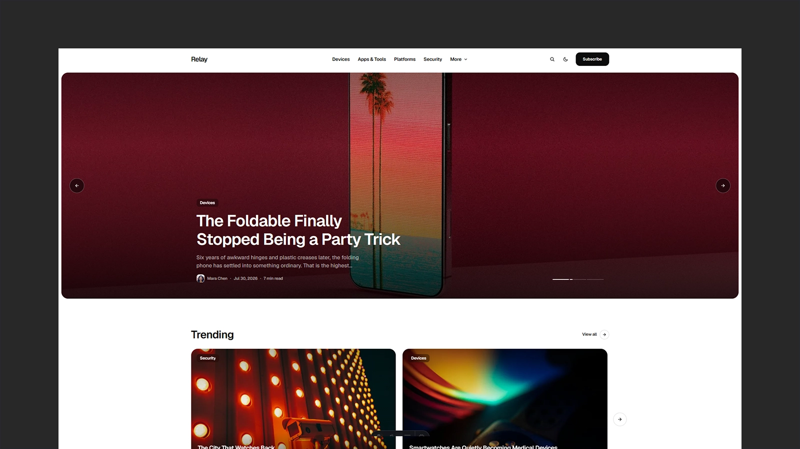

# Relay - Astro Technology Magazine Theme

[](https://relay.xocoweb.workers.dev/)

[](https://astro.build/)
[](https://tailwindcss.com/)
[](https://www.typescriptlang.org/)
[](./LICENSE)

**Live preview:** https://relay.xocoweb.workers.dev/

Relay is an Astro theme for technology publications and editorial blogs. It is monochrome by design so cover photography carries the colour, with a single signal accent held back for links and active state, softly rounded blocks, a photo-led front page, and system-aware light and dark modes. Categories, navigation, featured stories, and SEO defaults all come from a small set of config files, so a publication can be renamed and re-scoped without editing components. Content is plain Markdown validated by Astro content collections, and the output is mostly static: fast pages, crawlable articles, and no framework islands to hydrate.

## Features

- Photo-led front page: an autoplaying featured slideshow, trending and category rails, topic tiles, and a latest-posts section that pairs a card grid and editorial rows with a sidebar of editor's picks, most-read stories, and contributors
- Scroll-snap rails that page horizontally on small screens and collapse into a plain grid on large ones — no carousel library
- Article pages with a title-first header, an 820px reading column, a reading-progress bar, share and copy-link actions, an author box, and a related rail
- Dynamic category pages with configurable featured, grid, and editorial list layouts
- Tag, author, archive, article, RSS, robots, and 404 pages
- Built-in client-side search with a keyboard-friendly command palette, ranked metadata matches, and a dedicated results page
- Markdown content powered by Astro content collections, with dual light/dark syntax-highlighted code blocks (plus a copy button), styled lists, and blockquotes
- Frontmatter validation for titles, excerpts, categories, dates, authors, tags, covers, trending, and drafts
- Read time calculated from the post body at build time, at a configurable reading speed — nothing to maintain by hand
- Central site, navigation, social, and SEO defaults
- Canonical URLs, sitemap generation, RSS, Open Graph, Twitter/X cards, and JSON-LD
- Accessible skip link, landmarks, labels, keyboard-friendly controls, and visible focus states
- System-aware light and dark modes with a saved reader preference and tiny inline JavaScript only where needed
- Responsive Astro image handling for theme-controlled story images
- Tailwind CSS 4 tokens with no external font requests by default
- Provider-neutral newsletter configuration and static about, contact, and privacy starter pages

## Tech Stack

- Astro 7
- Tailwind CSS 4 via the Vite plugin
- Vite 8
- TypeScript
- Astro content collections
- `@astrojs/sitemap`
- `@astrojs/markdown-remark` with `rehype-slug` for heading anchors
- Sharp for image processing

## Requirements

- Node.js `22.12.0` or newer
- npm

## Getting Started

```bash
npm install
npm run dev
```

Build for production:

```bash
npm run build
```

Preview the production build locally:

```bash
npm run preview
```

## Customization

See [CUSTOMIZATION.md](./CUSTOMIZATION.md) for site settings, categories, newsletter and contact forms, frontmatter, images, code blocks, icons, pages, search, fonts, and theme tokens. The default color mode is set in [src/layouts/BaseLayout.astro](./src/layouts/BaseLayout.astro).

## Content

Posts live in [src/content/posts](./src/content/posts). Each post is a folder with an `index.md` and a `cover.jpg`. Frontmatter is validated by the schema in [src/content.config.ts](./src/content.config.ts).

The bundled demo covers come from [Unsplash](https://unsplash.com/) under the Unsplash License; each post credits its photographer in frontmatter. Replace them with your own imagery before publishing.

Author portraits live in [src/config/authors.ts](./src/config/authors.ts), keyed by the `author.name` used in post frontmatter, with the images in `src/assets/authors`. Names with no entry fall back to a monogram avatar. The bundled portraits are Unsplash placeholders — the people photographed have no connection to these fictional bylines, so swap in photos of your real contributors before publishing.

## Support

See [SUPPORT.md](./SUPPORT.md) for what is included with a license.

## License

Commercial license. See [LICENSE](./LICENSE) for complete terms.
